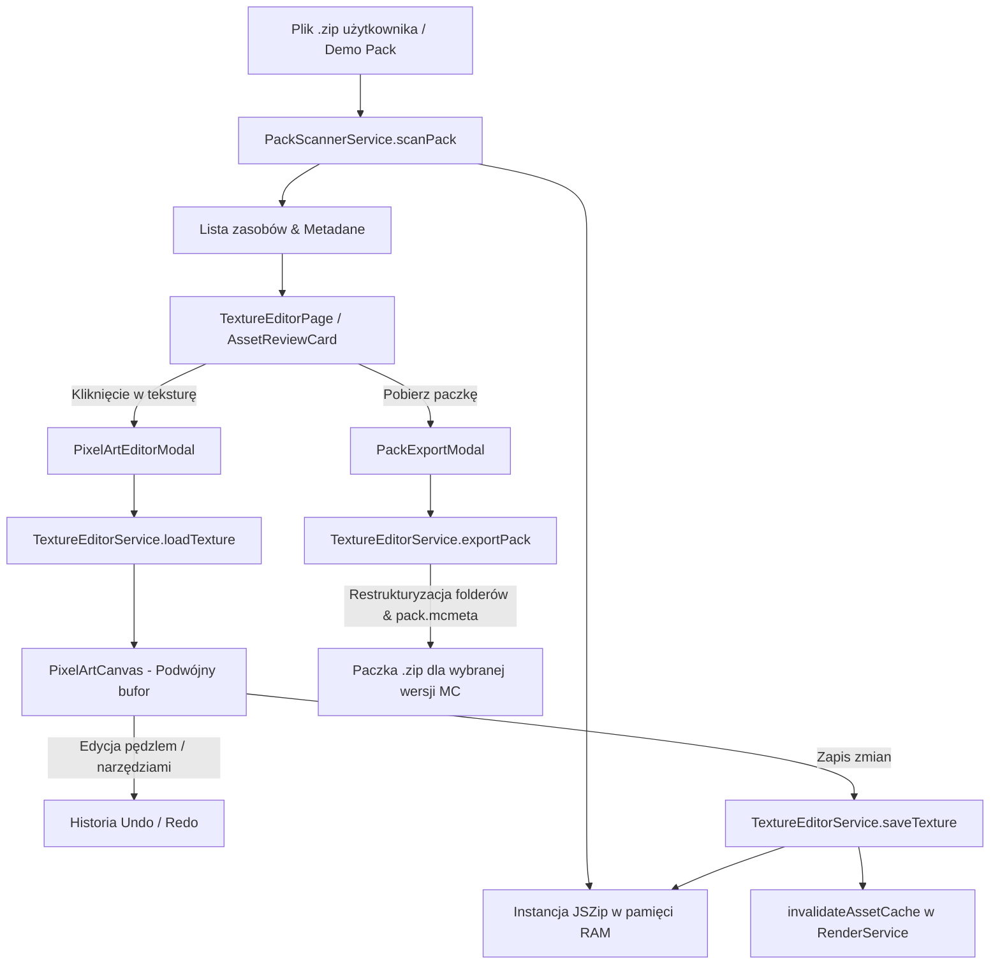

# 📖 Kompleksowa Dokumentacja Techniczna — BarleyTxT Studio

Niniejszy dokument przedstawia szczegółową architekturę techniczną, specyfikację algorytmów graficznych, strukturę danych oraz przepływy logiki w systemie BarleyTxT, ze szczególnym uwzględnieniem modułu **Edytora Tekstur Pixel Art**, silnika **WebGL 3D** oraz generatora paczek zasobów Minecraft.

---

## 1. Architektura Systemu i Przepływ Danych

Aplikacja funkcjonuje w oparciu o architekturę **Client-Side Heavy**, co oznacza, że cała praca związana z dekompresją archiwów ZIP, parsowaniem modeli JSON, rysowaniem pikselowym oraz kompresją wyjściową odbywa się po stronie przeglądarki użytkownika bez obciążania serwera.

### 1.1. Schemat Przepływu Danych w Edytorze Tekstur



---

## 2. Moduł Edytora Tekstur (Pixel Art Studio)

Moduł edytora zlokalizowany jest w `src/components/editor/` oraz `src/services/TextureEditorService.js`. Zapewnia on interaktywne narzędzia tworzenia i edycji grafik rastrowych o małych rozdzielczościach (16x16, 32x32, 64x64, 128x128).

### 2.1. Podwójny Bufor Płótna (Dual Canvas Architecture)
W komponencie `PixelArtCanvas.jsx` zastosowano architekturę podwójnego bufora:
1. **Offscreen Canvas (`pixelCanvasRef`)**:
   - Posiada dokładne, natywne wymiary tekstury (np. 16x16 pikseli).
   - Przechowuje bezwzględny stan surowych pikseli RGBA.
   - Wykorzystuje kontekst `2d` z opcją `{ willReadFrequently: true }`, co drastycznie redukuje koszt odczytów `getImageData()`.
   - Z niego generowane są stany historii (`toDataURL('image/png')`).
2. **Display Canvas (`displayCanvasRef`)**:
   - Posiada powiększone wymiary ekranowe (`width * zoom` x `height * zoom`).
   - Odpowiada za wyświetlanie powiększonego obrazu na ekranie przy użyciu `imageSmoothingEnabled = false` (algorytm skalowania Nearest-Neighbor zapobiegający rozmyciu).
   - Rysuje podkładową szachownicę przezroczystości (checkerboard).
   - Rysuje siatkę pikseli (widoczną dla powiększenia >= 8x).
   - Rysuje tymczasowy podgląd kształtów (linia, prostokąt, okrąg) podczas przeciągania myszą bez modyfikowania bufora głównego.

---

### 2.2. Algorytmy Graficzne

#### A. Rysowanie Linii — Algorytm Bresenhama (`getLinePixels`)
Stosowany zarówno przy narzędziu **Linia**, jak i przy szybkim swobodnym rysowaniu pędzlem do interpolacji brakujących pikseli między zdarzeniami `pointermove`:
```javascript
function getLinePixels(x0, y0, x1, y1) {
  const points = [];
  const dx = Math.abs(x1 - x0);
  const dy = Math.abs(y1 - y0);
  const sx = x0 < x1 ? 1 : -1;
  const sy = y0 < y1 ? 1 : -1;
  let err = dx - dy;
  let currX = x0;
  let currY = y0;

  while (true) {
    points.push({ x: currX, y: currY });
    if (currX === x1 && currY === y1) break;
    const e2 = 2 * err;
    if (e2 > -dy) {
      err -= dy;
      currX += sx;
    }
    if (e2 < dx) {
      err += dx;
      currY += sy;
    }
  }
  return points;
}
```

#### B. Wypełnianie Płaskie — Algorytm Flood Fill (`performFloodFill`)
Zaimplementowany w oparciu o kolejkę FIFO/BFS z tablicą `visited` (`Uint8Array(width * height)`).
- **Zabezpieczenie przed Stack Overflow**: Rezygnacja z klasycznej rekurencji na rzecz kolejki iteracyjnej eliminuje ryzyko przekroczenia limitu stosu wywołań JavaScriptu.
- **Obsługa transparencji**: Porównywane są 4 kanały (R, G, B, A).

#### C. Globalna Zamiana Koloru (`performColorReplace`)
W odróżnieniu od Flood Fill, to narzędzie dokonuje jednoprzebiegowej zamiany koloru (`O(N)`):
- Iteruje po tablicy `Uint8ClampedArray` co 4 bajty.
- Wszelkie piksele o identycznym kolorze źródłowym (R, G, B, A) zostają natychmiast zamienione na kolor docelowy.
- Przydatne przy szybkiej zmianie motywu kolorystycznego tekstury (np. zamiana diamentu na rubin).

#### D. Algorytm Okręgów i Kół (`getCirclePixels`)
- Wersja obrysu: Dyskretny algorytm punktu środkowego Bresenhama z 8-krotną symetrią.
- Wersja wypełniona: Sprawdzenie nierówności koła `dx*dx + dy*dy <= r*r + r` wewnątrz kwadratu otaczającego.

#### E. Narzędzia Dodge & Burn (`TextureEditorService.shiftBrightness`)
Przeliczają kanały RGB koloru piksela o zadany procent:
- `Dodge` (Rozjaśnienie): `+12%` składowych RGB z obcięciem do 255.
- `Burn` (Przyciemnienie): `-12%` składowych RGB z dolnym limitem 0.
- Zachowuje oryginalną wartość kanału Alpha.

#### F. Narzędzie Ditheringu (Półtony)
Wykorzystuje warunek parzystości współrzędnych `(x + y) % 2 === 0`, nakładając wzór szachownicy pikseli 50% stipple, charakterystyczny dla cieniowania w pixel arcie.

---

### 2.3. Ekstrakcja Palety i Zarządzanie Kolorami
- `extractPaletteFromImageData()`:
  - Zlicza wystąpienia kolorów za pomocą struktury `Map`.
  - Filtruje piksele przezroczyste (`alpha < 10`).
  - Sortuje unikalne kolory malejąco według częstotliwości występowania i zwraca najpopularniejsze 24-32 odcienie.
- `MINECRAFT_PRESET_PALETTES`:
  - 10 predefiniowanych palet wiernie odwzorowujących materiały z gry: Diament, Netheryt, Złoto, Żelazo, Redstone, Szmaragd, Lapis Lazuli, Drewno Dębowe, Kamień, Podstawowe.
- Pamięć lokalna: Własna paleta użytkownika synchronizowana jest z `localStorage` pod kluczem `barley_custom_palette`.

---

## 3. Kompatybilność Wersji Minecraft i Eksport Paczek

Jednym z najważniejszych elementów `TextureEditorService` jest bezbłędna obsługa formatów paczek zasobów między różnymi wersjami Minecraft.

### 3.1. Tabela Formatów `pack_format`

| Wersja Minecraft | `pack_format` | Główna zmiana w strukturze plików |
|---|:---:|---|
| **1.8.9** | `1` | Foldery w liczbie mnogiej: `textures/items/` oraz `textures/blocks/` |
| **1.12.2** | `3` | Podtrzymanie struktury 1.8 z rozszerzonymi nazwami bloków |
| **1.16.5** | `6` | Liczba pojedyncza: `textures/item/` oraz `textures/block/` (The Flattening) |
| **1.18.2** | `8` | Nowy generator świata i rozszerzenia shaderów |
| **1.19.4** | `13` | Wprowadzenie Display Entities i nowych definicji atlasów |
| **1.20 - 1.20.1** | `15` | Trails & Tales — szablony zbroi (armor trims) |
| **1.20.2 - 1.20.4** | `18` | Podział tekstur GUI na sprite'y i atlasy |
| **1.21+** | `34` | Tricky Trials — zaktualizowane formaty komponentów danych |

### 3.2. Reguły Przekształceń Ścieżek
W metodzie `exportPack()` wykonywane są następujące operacje:
1. **Dla wersji klasycznych (1.8 - 1.12, format <= 3)**:
   - Każdy plik ze ścieżki `textures/item/*` jest duplikowany/kopiowany do `textures/items/*`.
   - Każdy plik ze ścieżki `textures/block/*` jest duplikowany/kopiowany do `textures/blocks/*`.
2. **Dla wersji nowoczesnych (1.13+, format >= 4)**:
   - Pliki ze ścieżek w liczbie mnogiej (`items/`, `blocks/`) są standaryzowane do liczby pojedynczej (`item/`, `block/`).
3. **Plik `pack.mcmeta`**:
   - Generowany w głównym katalogu archiwum z zachowaniem struktury JSON:
     ```json
     {
       "pack": {
         "pack_format": 34,
         "description": "Opis paczki zasobów"
       }
     }
     ```
4. **Ikona Paczki (`pack.png`)**:
   - Jeśli użytkownik wgra własną ikonę lub wybierze domyślną, zostaje ona zakodowana do formatu PNG i umieszczona w rogu archiwum jako `pack.png`.

---

## 4. Moduł Skanera i Silnik 3D

### 4.1. `PackScannerService.js`
Odpowiada za inspekcję archiwum ZIP w poszukiwaniu elementów paczki:
- **Rozpoznawanie kategorii**: Automatyczna klasyfikacja na podstawie ścieżek (`textures/item`, `textures/block`, `textures/models/armor`, `textures/gui`, `textures/particle`).
- **Obsługa animacji (`.mcmeta`)**: Wykrywanie tekstur z klatkami animowanymi (np. animowany ogień, lawa, miecz).
- **Obsługa wariantów CustomModelData (CMD)**: Parsowanie plików JSON modeli przedmiotów i odczytywanie tablicy `overrides` pod kątem predykatu `custom_model_data`.

### 4.2. `RenderService.js`
Integruje silniki renderowania 3D w WebGL:
- **`BlockModelRenderer`**: Renderuje bloki z plikami modeli JSON w trójwymiarowej scenie z oświetleniem kierunkowym.
- **`skinview3d`**: Wyświetla modele postaci gracza ze zbrojami warstwowymi (`layer_1`, `layer_2`) oraz skrzydłami Elytry.
- **`invalidateAssetCache(assetId)`**: Funkcja unieważniająca pamięć podręczną wygenerowanych miniaturek 3D po dokonaniu edycji tekstury w edytorze.

---

## 5. Dobre Praktyki i Wytyczne Rozwoju

1. **Nienaruszalność Danych Użytkownika**: Wszelkie operacje zapisu w `TextureEditorService` pracują na klonach struktur w pamięci (`new JSZip()`), co gwarantuje brak uszkodzenia stanu roboczego w razie błędu eksportu.
2. **Optymalizacja Pamięciowa**: Duże obiekty Blob generowane z canvasu powinny być zwalniane za pomocą `URL.revokeObjectURL()` po zakończeniu pobierania.
3. **Standardy Dostępności**: Wszystkie narzędzia w edytorze posiadają czytelne etykiety, wizualny wskaźnik aktywnego stanu oraz odpowiedniki klawiaturowe.
